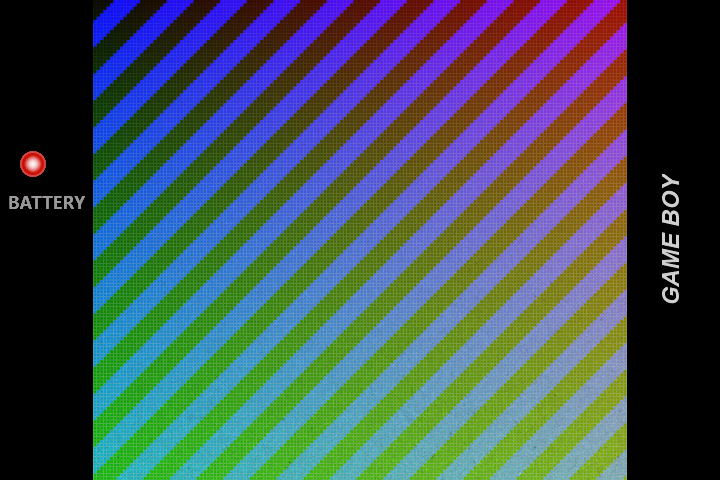
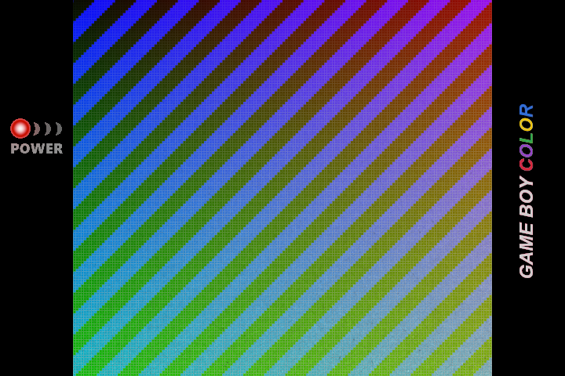
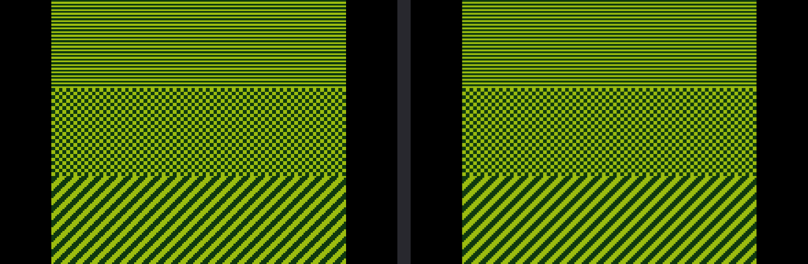
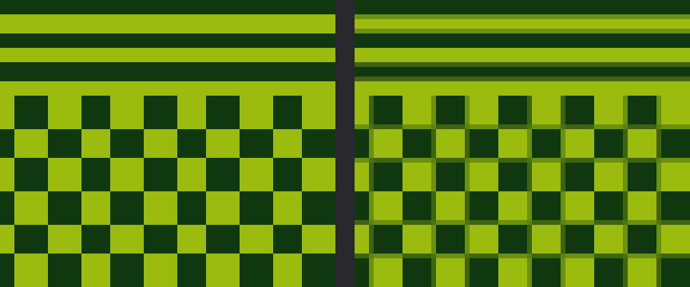

---

# What is slot?

A bespoke, Game Boy-centric frontend for the Anbernic RG SP.

Has support for GBA, GBC, and GB titles only.

> [!IMPORTANT]
> ROMs must be unzipped. slot does not read `.zip` or `.7z` files.

A full user guide can be found at [slot-cfw.fyi](https://slot-cfw.fyi).

Release notes can be found in the [changelog](CHANGELOG.md).

---

# What does it look like?

---

# Supported Devices

| Device             | Supported                                    | Since Version |
|--------------------|----------------------------------------------|---------------|
| Anbernic RG SP     | Yes                                          | Always        |
| Anbernic RG34XX    | Yes                                          | 1.4.0         |
| Anbernic RG34XXSP  | Yes                                          | 1.4.0         |
| Anbernic RG35XXSP  | Yes                                          | 1.5.0         |
| Anbernic 35XX Plus | Yes                                          | 1.5.0         |
| Anbernic RG28XX    | Yes                                          | 1.6.0         |
| Anbernic RG35XX-H  | Yes                                          | 1.7.0         |

If you have one of the untested devices, or have tried slot on a device not listed,
please [open an issue on GitHub](https://github.com/BrandonKowalski/slot/issues) and let me know how it went.

---

# What does this fork bring?

This is [slot-gb-custom](https://github.com/Maxcimkj/slot-gb-custom), a fork of
[slot](https://github.com/BrandonKowalski/slot) with one addition: a **Fit** picture mode for
Game Boy and Game Boy Color games.

## Fit mode for GB and GBC

slot shows GB and GBC games in two modes: **Actual** (exact 3x, with the bezel) and **Stretch**
(full width, no bezel).

> [!IMPORTANT]
> **The fork adds Fit between them.** Fit fills the whole screen height and keeps the Game Boy's
> own 10:9 shape, so the picture is about 533x480 with a bar on each side.

- **L1** steps bigger: Actual → Fit → Stretch.
- **R1** steps smaller: Stretch → Fit → Actual.
- The mode is saved per game, like slot's other picture modes.
- The side bars get a Fit version of the built-in Game Boy and Game Boy Color bezels.
- Fit is softened with a sharp-bilinear filter. At 3.33x, plain nearest-neighbour scaling makes
  rows alternate between 3 and 4 pixels tall, which shows as shimmer when the game scrolls.
- GBA games have no Fit mode and are not affected.

### Fit with bezels

The side bars hold Fit versions of the built-in bezels: Game Boy (left) and Game Boy Color (right).

### Fit softened

In each picture, the left side is hard pixels at 3.33x and the right side is the softened Fit
picture: every row ends up the same height.

### Screen sizes

Fit is designed for 3:2 panels such as the RG SP (720x480), where the side bars are about 93 px
wide. On 4:3 panels it still works, but thin bars stay at the top and bottom.

## Always on the newest slot

The fork keeps up with upstream on its own. Once a day, a workflow merges any new slot changes
into the fork, re-applies Fit on top, runs the build and the fork's tests, and publishes a new
fork release, so the fork stays on the newest slot version.

Fork releases are tagged `v<slot version>-gp-custom.<n>`, for example `v1.9.0-gp-custom.1` is
slot 1.9.0 plus Fit. Their release notes are slot's.

> [!IMPORTANT]
> **Download the latest fork release from the
> [releases page](https://github.com/Maxcimkj/slot-gb-custom/releases/latest).** Install it the
> same way as slot.

## Full slot documentation

For everything else (installation, controls, cores, bezels, link play, settings), see the
[slot README](https://github.com/BrandonKowalski/slot/blob/main/README.md) and the
user guide at [slot-cfw.fyi](https://slot-cfw.fyi).
